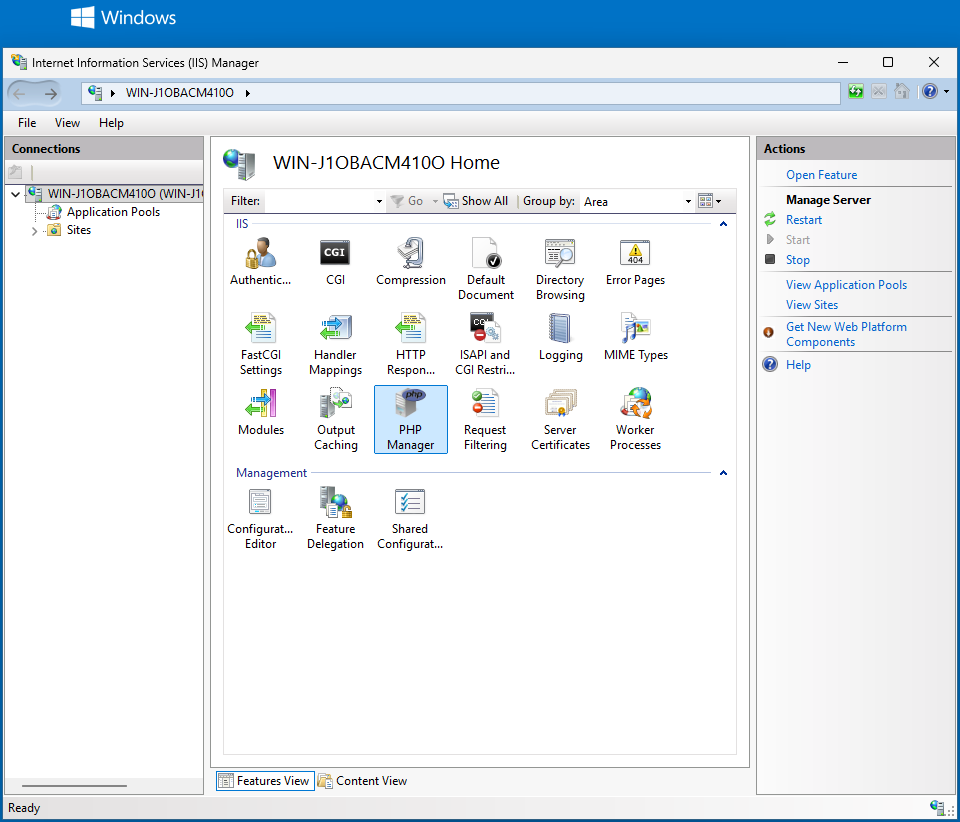
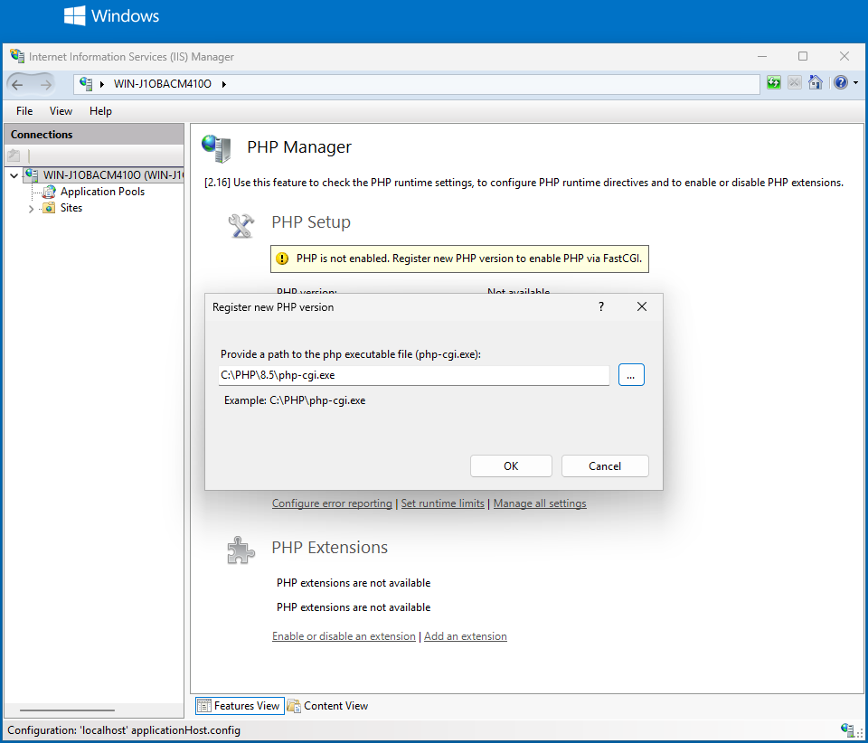
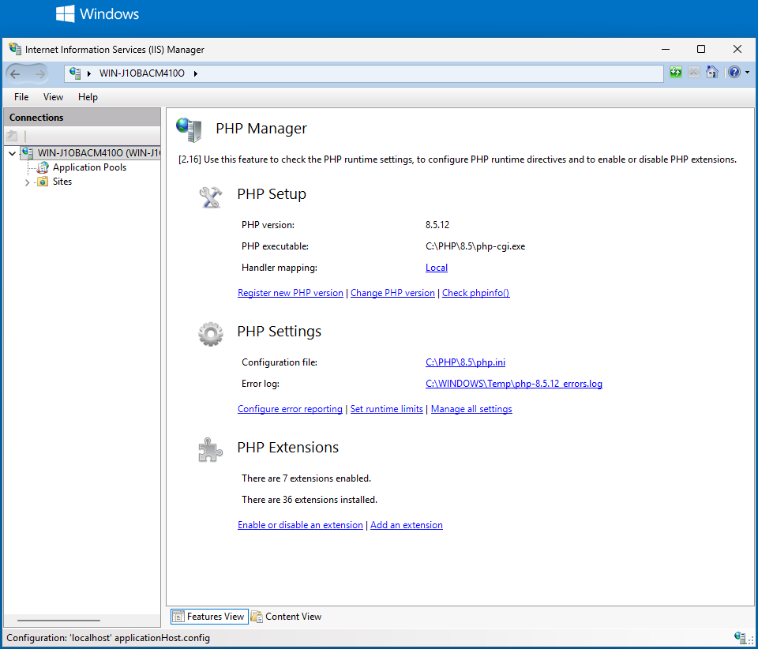
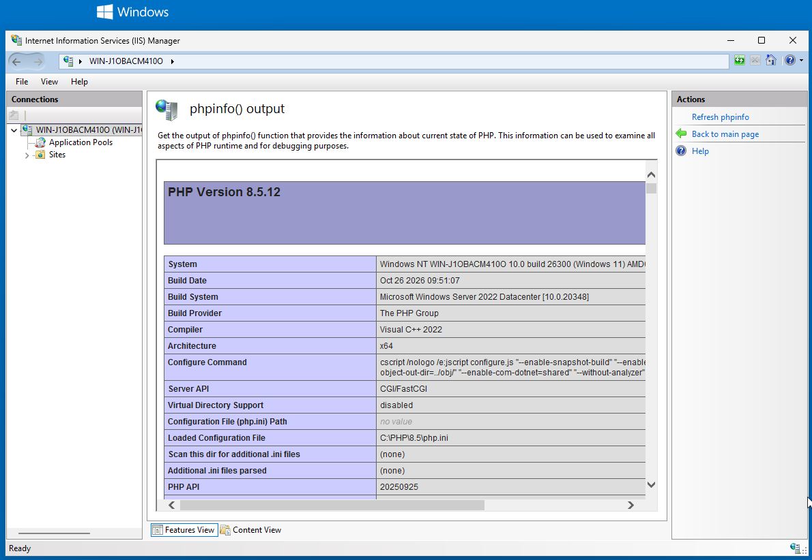
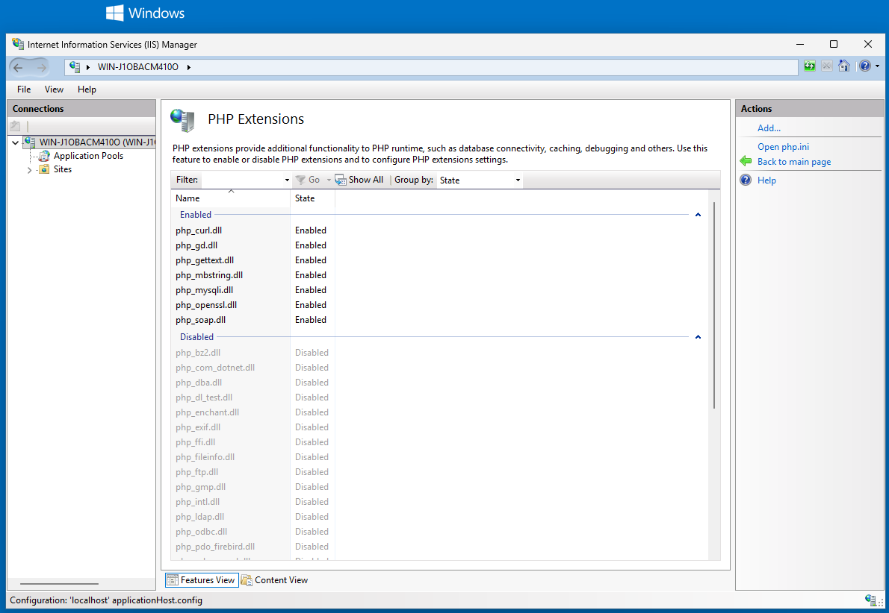
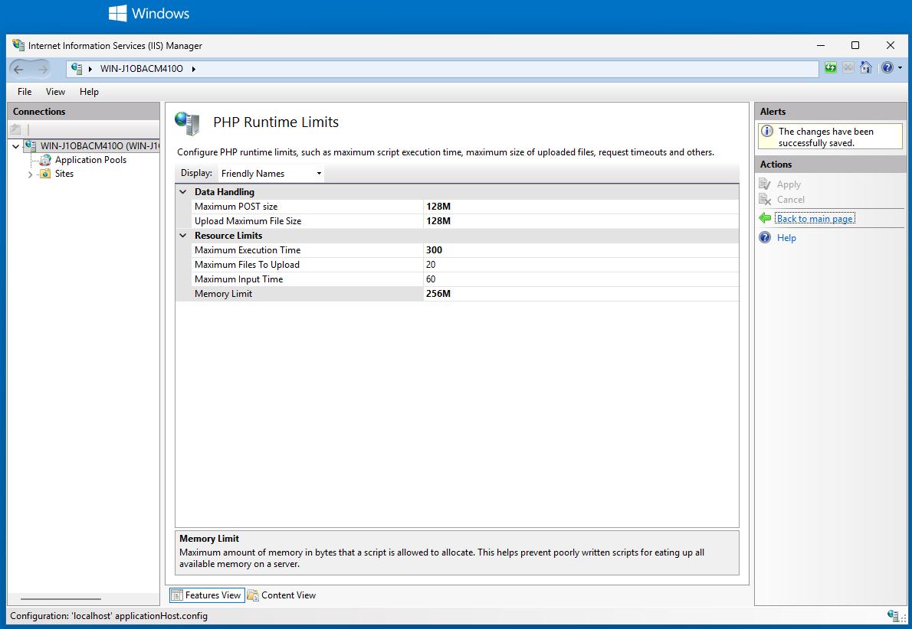
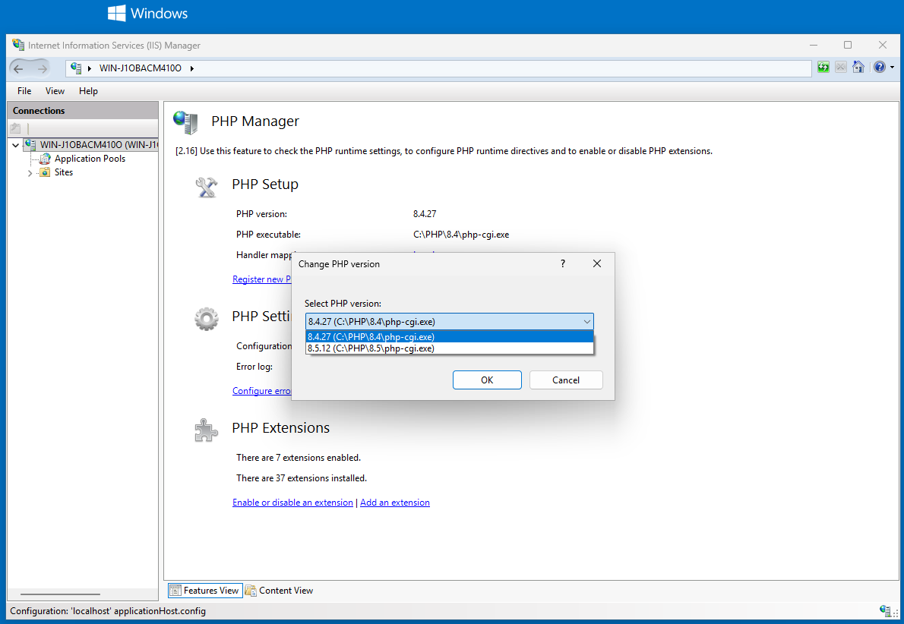

# PHP Manager 2 for IIS

[](https://github.com/jsuomi/phpmanager/actions/workflows/dotnet-desktop.yml)
[](https://github.com/jsuomi/phpmanager/actions/workflows/msi-test.yml)

See [CHANGELOG.md](CHANGELOG.md) for what changed in each release of this fork.

---

# IMPORTANT WARNING

- This is a private fork of the public archive for phpmanager
- This is an attempt to add a few more versions of PHP to the installer
- No guarantees of any kind are given, everything is provided "as-is" under [MS-PL](https://opensource.org/license/ms-pl)

**You were warned.**

---

## Installation and setup

### Quick setup with PowerShell

This script does steps 1 to 4 below in one go:
1. adds IIS with CGI and IIS Manager
2. installs the newest PHP Manager release, after checking it against `SHA256SUMS.txt`
3. installs the Visual C++ runtime
4. downloads PHP into `C:\PHP\<version>`, after checking it against windows.php.net's hash
5. registers that PHP with IIS

Run it in **Windows PowerShell as administrator**, not PowerShell 7: the PHP Manager cmdlets only load in Windows PowerShell 5.1. Paste the whole block at once; it stops at the first failed step. Set `$PhpBranch` to the PHP version you want. To add another PHP version later, run it again with a different `$PhpBranch`; the other parts are safe to repeat. Open a new window each time: the script loads the PHP Manager cmdlets, and if a newer PHP Manager is installed from a window that has them loaded, Windows Installer closes that window to replace their files.

```powershell
& {
$PhpBranch = '8.5'                                   # PHP version to install
$PhpDir    = "C:\PHP\$PhpBranch"                     # must not exist yet, or be empty
$dl        = Join-Path $env:TEMP 'phpmanager-setup'  # downloads go here

if ($PSVersionTable.PSEdition -ne 'Desktop') { throw 'Run this in Windows PowerShell 5.1, not PowerShell 7.' }
if (-not ([Security.Principal.WindowsPrincipal][Security.Principal.WindowsIdentity]::GetCurrent()).IsInRole('Administrators')) { throw 'Run this as administrator.' }
$ErrorActionPreference = 'Stop'
$ProgressPreference = 'SilentlyContinue'             # much faster downloads in Windows PowerShell
[Net.ServicePointManager]::SecurityProtocol = [Net.ServicePointManager]::SecurityProtocol -bor [Net.SecurityProtocolType]::Tls12
New-Item -ItemType Directory -Force $dl | Out-Null

# 1. IIS with CGI (FastCGI) and IIS Manager
if ((Get-CimInstance Win32_OperatingSystem).ProductType -eq 1) {
    Enable-WindowsOptionalFeature -Online -All -NoRestart -FeatureName IIS-WebServerRole, IIS-CGI, IIS-ManagementConsole | Out-Null
} else {
    Install-WindowsFeature -Name Web-Server, Web-CGI -IncludeManagementTools | Out-Null
}

# 2. PHP Manager: the newest release, checked against SHA256SUMS.txt
$release = Invoke-RestMethod https://api.github.com/repos/jsuomi/phpmanager/releases/latest
$msi  = $release.assets | Where-Object name -like '*-x64.msi'
$sums = $release.assets | Where-Object name -eq 'SHA256SUMS.txt'
Invoke-WebRequest $msi.browser_download_url -OutFile "$dl\$($msi.name)"
Invoke-WebRequest $sums.browser_download_url -OutFile "$dl\SHA256SUMS.txt"
$expected = (Select-String -Path "$dl\SHA256SUMS.txt" -SimpleMatch $msi.name).Line.Split(' ')[0]
if ((Get-FileHash "$dl\$($msi.name)").Hash -ne $expected) { throw "$($msi.name) does not match SHA256SUMS.txt" }
$p = Start-Process msiexec.exe -Wait -PassThru -ArgumentList '/i', "`"$dl\$($msi.name)`"", '/passive', '/norestart'
if ($p.ExitCode -notin 0, 3010) { throw "PHP Manager setup failed with exit code $($p.ExitCode)" }

# 3. Visual C++ runtime, x64. On ARM64 Windows it installs ARM64 parts too, which is expected.
Invoke-WebRequest https://aka.ms/vs/17/release/vc_redist.x64.exe -OutFile "$dl\vc_redist.x64.exe"
$p = Start-Process "$dl\vc_redist.x64.exe" -Wait -PassThru -ArgumentList '/install', '/passive', '/norestart'
if ($p.ExitCode -notin 0, 1638, 3010) { throw "Visual C++ runtime setup failed with exit code $($p.ExitCode)" }   # 1638: a newer one is installed

# 4. PHP: the Non Thread Safe x64 build, checked against windows.php.net's releases.json
$php = (Invoke-RestMethod https://downloads.php.net/~windows/releases/releases.json).$PhpBranch
if (-not $php) { throw "windows.php.net has no current build of PHP $PhpBranch" }
$zip = ($php.PSObject.Properties | Where-Object Name -match '^nts-v[cs]\d+-x64$' | Select-Object -First 1).Value.zip
Invoke-WebRequest "https://downloads.php.net/~windows/releases/$($zip.path)" -OutFile "$dl\$($zip.path)"
if ((Get-FileHash "$dl\$($zip.path)").Hash -ne $zip.sha256) { throw "$($zip.path) does not match releases.json" }
Expand-Archive "$dl\$($zip.path)" -DestinationPath $PhpDir

# 5. Register PHP with IIS and show the result
if (-not (Get-PSSnapin PHPManagerSnapin -ErrorAction SilentlyContinue)) { Add-PSSnapin PHPManagerSnapin }
New-PHPVersion -ScriptProcessor "$PhpDir\php-cgi.exe"
Get-PHPConfiguration
}
```

Then check it with **Check phpinfo()** in IIS Manager (step 5), and configure PHP (step 6). The downloads in `%TEMP%\phpmanager-setup` can be deleted afterwards.

The same setup by hand:

### 1. Check the requirements

- Windows Server 2012 / Windows 8 or later, with IIS 8 or later
- .NET Framework 4.6.2 or later (built into Windows Server 2016 and later)
- IIS with the **CGI** feature, which provides FastCGI, and the **IIS Management Console**

Windows 11 on ARM64 works too: version 2.16.0 has been tested there with the x64 MSI, the x64 PHP build and the x64 Visual C++ runtime. PHP has no ARM64 Windows builds, so x64 PHP runs under emulation.

To add the IIS features, run this in an elevated PowerShell on Windows Server:

```powershell
Install-WindowsFeature -Name Web-Server, Web-CGI -IncludeManagementTools
```

On Windows 10 or 11:

```powershell
Enable-WindowsOptionalFeature -Online -All -FeatureName IIS-WebServerRole, IIS-CGI, IIS-ManagementConsole
```

### 2. Install PHP Manager

1. Download `PHPManagerForIIS-<version>-x64.msi` and `SHA256SUMS.txt` from [Releases](https://github.com/jsuomi/phpmanager/releases). Use the x86 MSI only on 32-bit Windows.
2. Optional: check the download. The installers are not code-signed.
   - `Get-FileHash -Algorithm SHA256 .\PHPManagerForIIS-<version>-x64.msi` must match the line in `SHA256SUMS.txt`
   - With the GitHub CLI: `gh attestation verify PHPManagerForIIS-<version>-x64.msi -R jsuomi/phpmanager`
3. Close IIS Manager and run the MSI as an administrator.

To upgrade, run the newer MSI. It replaces the installed version and keeps your PHP registrations.

### 3. Download PHP

1. Get PHP from [windows.php.net/download](https://windows.php.net/download/). Pick the **Non Thread Safe** (NTS) x64 zip: IIS runs PHP through FastCGI, which uses the NTS build.
2. Extract it to its own folder, such as `C:\PHP\8.5`. Use one folder per PHP version.
3. Install the Visual C++ runtime the build needs. The download page names it, such as VS17 for PHP 8.4 and later. The [latest Visual C++ Redistributable](https://learn.microsoft.com/cpp/windows/latest-supported-vc-redist) (x64) covers VS16 and VS17 builds. On ARM64 Windows, the x64 installer also installs ARM64 parts; that's expected.

### 4. Register PHP with IIS

1. Open **IIS Manager** and select the server node.
2. Open **PHP Manager**. Until PHP is registered, it shows **PHP is not enabled**.

   

3. Under **PHP Setup**, choose **Register new PHP version** and browse to `php-cgi.exe`, e.g. `C:\PHP\8.5\php-cgi.exe`.

   

Registering PHP:

- adds a FastCGI application and a `*.php` handler mapping
- adds `index.php` as a default document
- creates `php.ini` from `php.ini-production` if the folder has no `php.ini`
- applies recommended settings and enables common extensions, such as curl, mbstring, mysqli, openssl and gd

The PHP Manager page then shows the PHP version, `php.ini` path and handler mapping:



If it shows **Not optimal PHP configuration detected on this machine**, choose **View recommendations**, select the issues and choose **OK** to fix them.

### 5. Check that PHP runs

Under **PHP Setup**, choose **Check phpinfo()**, then pick a site and URL. You should see the `phpinfo()` page for the version you registered, with **Server API** `CGI/FastCGI`.



### 6. Configure PHP

From the PHP Manager page:

- **PHP Settings**
  - **Configure error reporting**: choose **Development machine** or **Production machine**, and set the error log file
  - **Set runtime limits**: execution time, memory limit, upload and POST sizes
  - **Manage all settings**: add, edit or remove any `php.ini` directive. Set `date.timezone` here.
- **PHP Extensions**: **Enable or disable an extension**, or **Add an extension** from a DLL

**Open php.ini**, in the **Actions** pane of the settings and extensions pages, edits the file directly.





### 7. Choose the PHP version

Register each version you want to use (step 4), then:

- **Whole server**: select the server node, open **PHP Manager**, and choose **Change PHP version**. The list shows each registered version with its path.

  

- **One site**: select the site, open **PHP Manager**, and choose **Change PHP version**. The site then gets its own copy of the handler mappings, and its PHP Manager page shows **Handler mapping: Local** instead of **Inherited**. Later changes at server level don't reach that site.

PHP Manager warns when a version's security support ends within 180 days (**This PHP release will expire soon**) and after it has ended (**This PHP release is already obsolete**). It also warns when the Visual C++ runtime the version needs is missing. To move to a newer PHP, download it (step 3), register it (step 4), then change the version.

### PowerShell

The MSI also installs cmdlets as a snap-in for Windows PowerShell 5.1. They don't load in PowerShell 7 (`pwsh`). Run them elevated:

```powershell
Add-PSSnapin PHPManagerSnapin

New-PHPVersion -ScriptProcessor C:\PHP\8.5\php-cgi.exe   # register
Get-PHPVersion                                           # list registered versions and handler names
Set-PHPVersion -HandlerName php-8.5.12                   # make one active
Remove-PHPVersion -HandlerName php-8.4.27                # unregister one (2.17.0 and later)
Get-PHPConfiguration                                     # active version, php.ini path, extensions

Get-PHPExtension -Status Disabled                        # list extensions
Set-PHPExtension -Name php_intl.dll -Status Enabled
Set-PHPSetting -Name date.timezone -Value UTC
```

Add `-SiteName "Default Web Site"` to work on one site instead of the whole server.

---

## Removal and uninstallation

Uninstalling PHP Manager doesn't remove PHP from IIS: sites keep running PHP, unless you uninstall with `REMOVEPHP=1` (below).

From PHP Manager 2.17.0, a PHP version can be unregistered in two ways. Both remove its handler mapping and, at server level, its FastCGI application. Neither removes the active version while others are registered, and neither deletes PHP files.

- **IIS Manager**: open **PHP Manager**, choose **Remove PHP version** under **PHP Setup**, and pick the version. The list leaves out the active version unless it's the only one. On a site, this removes the version from that site only, which gives the site its own handler mappings.
- **PowerShell**: `Remove-PHPVersion`. Add `-SiteName` to remove it from one site only, and `-Force` to skip the confirmation:

  ```powershell
  Add-PSSnapin PHPManagerSnapin
  Remove-PHPVersion -HandlerName php-8.4.27
  ```

The steps and script below work with every version of PHP Manager, and also clean up all sites at once and delete the PHP folders.

### Remove PHP versions

By hand, for each version:

1. If it's the active version, first switch to a version you keep with **Change PHP version** (step 7).
2. In IIS Manager, select the server node, open **Handler Mappings**, and remove the mapping named after the version, such as `php-8.4.27`. `Get-PHPVersion` lists the names.
3. Open **FastCGI Settings** and remove the application whose **Full Path** is that version's `php-cgi.exe`.
4. For each site that shows **Handler mapping: Local** in PHP Manager, select the site, open **Handler Mappings**, and remove the mapping there too. **Revert to Parent** in the **Actions** pane also works, but it discards all of the site's own handler changes.
5. Delete the PHP folder, such as `C:\PHP\8.4`. If its files are in use, run `iisreset` first.

#### With PowerShell

This script does the steps above for one or more PHP versions, or all of them. Run it in **Windows PowerShell as administrator**, before uninstalling PHP Manager: it uses PHP Manager's cmdlets to find the registered versions.

Set `$Remove` to what to remove:
- `@('8.4')` removes every registered 8.4 release
- `@('8.4.27', '8.3')` removes one exact release and every 8.3 release
- `@('all')` removes every PHP version

The script lists the matching versions and asks before changing anything. If the active version is among them, it first makes the newest remaining version active. It removes the handler mappings from the server and from every site that has its own copy, then the FastCGI applications. With `$DeleteFolders`, it also deletes each version's folder, unless a remaining version lives in the same folder.

```powershell
& {
$Remove        = @('8.4')    # versions such as '8.4' or '8.4.27', or 'all'
$DeleteFolders = $true       # also delete each removed version's PHP folder

if ($PSVersionTable.PSEdition -ne 'Desktop') { throw 'Run this in Windows PowerShell 5.1, not PowerShell 7.' }
if (-not ([Security.Principal.WindowsPrincipal][Security.Principal.WindowsIdentity]::GetCurrent()).IsInRole('Administrators')) { throw 'Run this as administrator.' }
$ErrorActionPreference = 'Stop'
if (-not (Get-PSSnapin PHPManagerSnapin -ErrorAction SilentlyContinue)) { Add-PSSnapin PHPManagerSnapin }

# Pick the registered versions to remove
$all  = @(Get-PHPVersion)
$gone = @($all | Where-Object { $v = $_.Version; $Remove -contains 'all' -or @($Remove | Where-Object { $v -eq $_ -or $v -like "$_.*" }).Count -gt 0 })
$kept = @($all | Where-Object { $gone -notcontains $_ })
if ($gone.Count -eq 0) { throw "No registered PHP version matches $($Remove -join ', '). Registered: $($all.Version -join ', ')" }
$gone | Format-Table HandlerName, Version, ScriptProcessor, Active -AutoSize
if ((Read-Host 'Remove these PHP versions? (y/N)') -ne 'y') { Write-Host 'Nothing removed.'; return }

# Keep PHP running: switch to the newest remaining version first
if (@($gone | Where-Object Active).Count -gt 0 -and $kept.Count -gt 0) {
    $next = $kept | Sort-Object { [version]$_.Version } -Descending | Select-Object -First 1
    Set-PHPVersion -HandlerName $next.HandlerName
    Write-Host "Active PHP is now $($next.Version)."
}

# Remove the handler mappings and FastCGI applications
Add-Type -Path "$env:windir\System32\inetsrv\Microsoft.Web.Administration.dll"
$sm      = New-Object Microsoft.Web.Administration.ServerManager
$apphost = $sm.GetApplicationHostConfiguration()
$exes    = @($gone.ScriptProcessor)
function Remove-PhpHandlers($section, $where) {
    $handlers = $section.GetCollection()
    foreach ($h in @($handlers | Where-Object { $_.IsLocallyStored -and $exes -contains $_.GetAttributeValue('scriptProcessor') })) {
        Write-Host "Removing handler $($h.GetAttributeValue('name')) from $where"
        $handlers.Remove($h)
    }
}
Remove-PhpHandlers $apphost.GetSection('system.webServer/handlers') 'the server'
foreach ($site in $sm.Sites) {
    Remove-PhpHandlers $apphost.GetSection('system.webServer/handlers', $site.Name) "site $($site.Name)"
    try { Remove-PhpHandlers $sm.GetWebConfiguration($site.Name).GetSection('system.webServer/handlers') "site $($site.Name) web.config" }
    catch { Write-Warning "Could not read the web.config of site $($site.Name): $($_.Exception.Message)" }
}
$fastCgi = $apphost.GetSection('system.webServer/fastCgi').GetCollection()
foreach ($app in @($fastCgi | Where-Object { $exes -contains $_.GetAttributeValue('fullPath') })) {
    Write-Host "Removing FastCGI application $($app.GetAttributeValue('fullPath'))"
    $fastCgi.Remove($app)
}
$sm.CommitChanges()

# Delete the PHP folders
if ($DeleteFolders) {
    iisreset /restart | Out-Null   # stops php-cgi.exe processes that hold files open
    foreach ($dir in @($gone | ForEach-Object { Split-Path $_.ScriptProcessor } | Sort-Object -Unique)) {
        if ($dir.Length -le 3 -or @($kept | Where-Object { $_.ScriptProcessor -like "$dir\*" }).Count -gt 0) {
            Write-Warning "Kept ${dir}: it is a drive root or holds a remaining PHP version."
            continue
        }
        Remove-Item -Recurse -Force $dir
        Write-Host "Deleted $dir"
    }
}

if ($kept.Count -gt 0) { Get-PHPVersion | Format-Table -AutoSize } else { Write-Host 'No PHP versions are registered now.' }
}
```

The script covers mappings on the server and at the root of each site. A mapping copied into an application or folder inside a site still has to be removed in **Handler Mappings** there.

### Uninstall PHP Manager

Uninstall **PHP Manager 2 for IIS** in **Settings > Apps > Installed apps** (or **Programs and Features**), or in a **new** Windows PowerShell window as administrator. Use a new window if you ran the removal script or other PHP Manager cmdlets: Windows Installer closes any window that has them loaded.

```powershell
$app = Get-ItemProperty 'HKLM:\SOFTWARE\Microsoft\Windows\CurrentVersion\Uninstall\*' | Where-Object DisplayName -like 'PHP Manager 2 for IIS*'
Start-Process msiexec.exe -Wait -ArgumentList '/x', $app.PSChildName, '/passive', '/norestart'
```

This removes PHP Manager from IIS Manager, the PowerShell cmdlets, and its files. It keeps:

- the PHP versions registered in IIS, which keep serving PHP, unless you add `REMOVEPHP=1`
- the PHP folders and their `php.ini`
- the PHP error logs, such as `C:\Windows\Temp\php-8.5.12_errors.log`
- `index.php` as a default document
- the Visual C++ runtime

From PHP Manager 2.17.0, uninstalling with `REMOVEPHP=1` also unregisters every PHP version: it removes all FastCGI handler mappings for `*.php` from the server, from each site's own settings in `applicationHost.config` and from each site's root `web.config`, then their FastCGI applications. PHP files stay. Uninstalling from **Installed apps** never does this, because it can't pass the flag. In the script above, change the last line to:

```powershell
Start-Process msiexec.exe -Wait -ArgumentList '/x', $app.PSChildName, '/passive', '/norestart', 'REMOVEPHP=1'
```

### Remove PHP completely

1. Remove every PHP version, as above. With the script, set `$Remove = @('all')`. From 2.17.0, uninstalling with `REMOVEPHP=1` in step 2 does this for you, apart from deleting the PHP folders.
2. Uninstall PHP Manager.
3. Optional cleanup:
   - In **Default Document**, remove `index.php`.
   - Delete the PHP error logs from `C:\Windows\Temp`.
   - Remove the CGI feature if nothing else uses FastCGI: `Uninstall-WindowsFeature Web-CGI` on Windows Server, or `Disable-WindowsOptionalFeature -Online -FeatureName IIS-CGI` on Windows 10 or 11.

Leave the Visual C++ runtime installed unless you know nothing else needs it: other applications share it.

---

## Release checklist

- [ ] Check [php.net](https://www.php.net/supported-versions.php) for the supported PHP versions and their end of **security** support. `npm run check:php` compares the rows with php.net, and the [PHP versions workflow](https://github.com/jsuomi/phpmanager/actions/workflows/php-versions.yml) runs it on GitHub
- [ ] Update the rows in [PHPConfigHelper.cs](Server/Config/PHPConfigHelper.cs): add new versions and fix changed dates
- [ ] Bump `AssemblyVersion` and `AssemblyFileVersion` in [SharedAssembyInfo.cs](SharedAssembyInfo.cs), e.g. `2.16.0.0`
- [ ] Run `npm run changelog`. It adds a section for the new version to [CHANGELOG.md](CHANGELOG.md); commit that with the bump
- [ ] If a workflow changed, run `npm run check:actions`
- [ ] Optional test build: run the [Build MSI workflow](https://github.com/jsuomi/phpmanager/actions/workflows/dotnet-desktop.yml) by hand with the new version as `tag`
    - Download the artifact `PHPManagerForIIS-<version>.zip`, unzip it and run `shasum -a 256 -c SHA256SUMS.txt`
- [ ] Commit and push
- [ ] Tag that commit with the same version and push the tag: `git tag v2.16.0`, then `git push origin v2.16.0`
    - The workflow builds it and creates a draft release
    - The run fails if the tag and `AssemblyFileVersion` differ
- [ ] Check the draft has `PHPManagerForIIS-<version>-x64.msi`, `PHPManagerForIIS-<version>-x86.msi` and `SHA256SUMS.txt`
    - Download an MSI from the draft and run `gh attestation verify PHPManagerForIIS-<version>-x64.msi -R jsuomi/phpmanager`
- [ ] Check the [Test MSI workflow](https://github.com/jsuomi/phpmanager/actions/workflows/msi-test.yml) passed for the tag's build. It starts after each successful Build MSI run, installs the x64 MSI, and serves a page with each PHP version that php.net still supports. It also tests an upgrade from the previous published release
- [ ] Write the release notes: `npm run release-notes` prints a draft with the PHP version changes. Add other user-visible changes from the commits it lists. Claude can do this; [docs/ai/release-notes.md](docs/ai/release-notes.md) describes how
- [ ] Publish the release

If something is wrong before publishing: discard the draft, delete the tag locally and on GitHub, fix it, then tag again. After publishing, leave the tag alone and release a new version instead.
